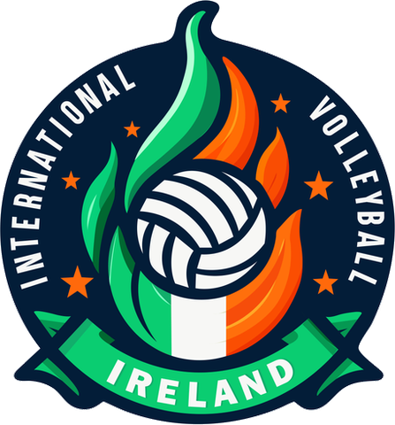

# IVI brand for the 5x1 pilot (internal)

Status: internal reference. Not published. Colours sampled from the IVI crest supplied on 14 Oct 2026; confirm the official values with IVI before public launch.

The crest in `assets/ivi-crest.png` is the full-colour version supplied on 14 Oct 2026, reduced to 480px with the white background made transparent. The earlier `assets/ivi-logo.jpg` is kept for reference only.

## Palette

| Token | Hex | Sampled share | Use in 5x1 |
| --- | --- | --- | --- |
| `ivi-navy` | `#021C37` | about 55% of the crest | Primary surfaces, headings, top bar |
| `ivi-green` | `#09CD71` | about 11% | Primary action, active states, success |
| `ivi-green-dark` | `#068551` | about 1% | Pressed states, borders on green |
| `ivi-orange` | `#FE6D09` | about 3% | Highlights, "waitlist" and attention states |
| `ivi-flame` | `#F84C04` | about 1% | Destructive or cancelled states |
| `ivi-white` | `#F8F8F5` | ball and lettering | Text on navy, card backgrounds |

Text contrast must still be checked against WCAG 2.2 AA. For example, white text on `ivi-green` is below 4.5:1, so use navy text on green buttons.

## Rules for the pilot

- The 5x1 interface uses these colours. The 5x1 name and mark are separate and are decided before public launch.
- Status colours are never the only signal: pair them with text or an icon (for example "Waitlist", not just orange).
- The crest is used on the club page only, at its original proportions, with clear space.

## Next steps

- Get IVI's official hex values and any brand guidelines.
- Turn these into design tokens during the visual design phase.
