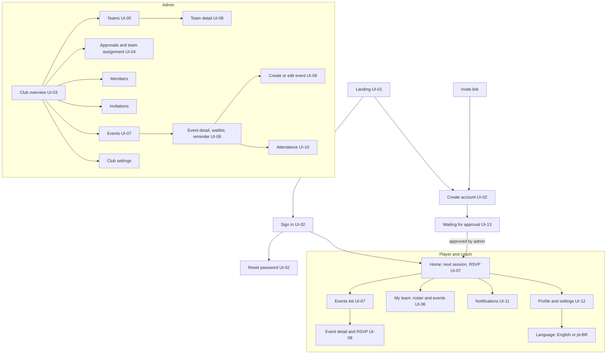

# 5x1 Sitemap and Navigation (v0.1, proposal for approval)

Status: approved for the pilot, 14 Oct 2026 (coach navigation and Teams placement decided, see below). Built from `docs/spec/03-FLOWS.md`, `04-DESIGN.md` (UI-01 to UI-13) and the high-fidelity screens in `docs/internal/design/hifi/`. Internal, not published.

Scope: the internal IVI pilot. Players without a team, and any screen for other clubs or public activities, are out of scope (see `product-spec.md`, decision 34).

## Site map

## Navigation by role

| Role | Bottom navigation (phone) | Where the rest lives |
| --- | --- | --- |
| Player (approved) | Home, Events, Team, Profile | Notifications from the bell on the top bar; language in Profile |
| Coach (assigned team) | Home, Events, Team, Profile | Attendance from the team event detail; no club-wide admin screens |
| Admin | Home, Events, Members, More | Teams and Approvals from Home tabs; Invitations, Attendance and Club settings from More |
| Pending member | None | Waiting message and Sign out only (UI-13) |
| Signed out | None | Landing, Sign in, Create account, Reset password |

Notes:
- The player bottom navigation matches the high-fidelity mock-ups (Home, Events, Team, Profile).
- The admin bottom navigation matches the admin mock-up (Home, Events, Members, More). Teams is reached from the Home tabs, as in the overview mock-up, so it is not a bottom tab.
- Notifications are reached from the bell on the top bar on every signed-in screen.
- Language is changed only in Profile (Settings), not on public screens (decision 25).

## Screen list

| Screen | Route name | Who | Source |
| --- | --- | --- | --- |
| Landing | `/` | Anyone | UI-01, `landing-v0.1` |
| Sign in | `/sign-in` | Anyone | UI-02, `landing-v0.1` |
| Create account | `/sign-up` (or from invite link `/join/[token]`) | Anyone with invite | UI-02, F02 |
| Reset password | `/reset` | Anyone | UI-02 |
| Waiting for approval | `/pending` | Pending member | UI-13, `approvals-v0.1` |
| Player home | `/home` | Player, coach | UI-07, `hifi-player-admin-v0.1` |
| Events list | `/events` | Player, coach, admin | UI-07 |
| Event detail and RSVP | `/events/[id]` | Player, coach, admin | UI-08 |
| My team | `/team` | Player, coach | UI-06 |
| Notifications | `/notifications` | All signed in | UI-11 |
| Profile and settings | `/profile` | All signed in | UI-12 |
| Club overview | `/admin` | Admin | UI-03, `hifi-player-admin-v0.1` |
| Approvals and team assignment | `/admin/approvals` | Admin | UI-04, `approvals-v0.1` |
| Teams | `/admin/teams` | Admin | UI-05 |
| Team detail | `/admin/teams/[id]` | Admin, coach (own team) | UI-06 |
| Members | `/admin/members` | Admin | UI-04 |
| Invitations | `/admin/invitations` | Admin | F02 |
| Create or edit event | `/admin/events/new`, `/admin/events/[id]/edit` | Admin, coach (own team) | UI-09 |
| Event detail (admin), waitlist | `/admin/events/[id]` | Admin, coach (own team) | UI-08, `eventatt-v0.1` |
| Attendance | `/events/[id]/attendance` | Admin, coach (own team, team events) | UI-10, `eventatt-v0.1` |
| Club settings | `/admin/settings` | Admin | UI-03 |

Route names are a proposal for the build phase. They must be the same in the English and pt-BR routes (`/en/...`, `/pt-BR/...`) as the TRD requires.

## Decisions (approved 14 Oct 2026)

1. **Coach navigation:** same bottom bar as a player (Home, Events, Team, Profile); attendance is opened from the team event.
2. **Teams placement:** admin Home tabs, not the bottom bar. Bottom bar stays Home, Events, Members, More.
3. **Notifications from the top bar bell** (not a tab), keeping the bottom bar to four items.
4. **Pending member sees only the waiting screen**, with no bottom bar (UI-13).

## Open items

- Tablet (768px) and desktop (1280px) navigation: the bottom bar becomes a side rail. Drawn and approved (15 Oct 2026) in `docs/internal/design/hifi/layouts-tablet-desktop-v0.1.html`.
- Empty states (no events, no team) for the internal pilot: an approved player always has a team, so the no-team state is out of scope.
