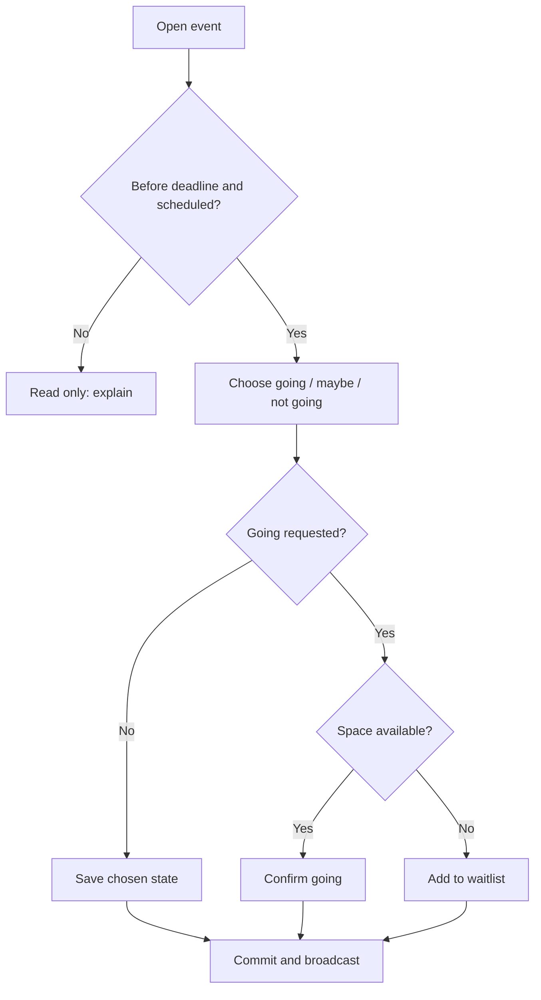

# FLOWS — User and System Flows
Version 0.1

## Flow F01 — Club creation
1. New user chooses pt-BR or en, signs up and verifies email if enabled.
2. User chooses `Criar clube / Create club`.
3. Enters club name, IANA timezone, optional image; validates.
4. Server creates club and active admin membership transactionally.
5. User sees setup checklist: add team, create invitation, schedule first event.
6. Record event for analytic success timer (start on authenticated setup; finish when first event is saved).
**Errors:** duplicate name allowed across clubs; malformed image, permission failure, network failure, interrupted submission are handled. Prevent duplicate creation from repeated clicks.

## Flow F02 — Join and roster
1. Admin generates expiring/revocable invite link (token securely hashed at rest).
2. Player opens token -> login/signup -> token validated -> membership request created or permitted instant join.
3. Admin reviews pending members and approves/declines.
4. Admin assigns one or more teams (division/gender category are team properties, not user properties).
5. Player sees own team roster and relevant events.
**Errors:** expired/revoked invite, duplicate membership, club mismatch, unauthorized approval; do not reveal unnecessary existing-account details.

## Flow F03 — Events and RSVP
1. Authorized coach selects assigned team (or admin selects team/club-wide), enters title/type/date/start/end/venue/optional capacity (blank = no limit)/deadline (pre-filled to 2 hours before start). Social events may be set to `mixed`.
2. Server verifies permission, timezone date ordering and event constraints.
3. Members in scope see event and respond Going / Not going / Maybe.
4. Server serializes concurrent updates and computes capacity.
5. If going slots remain: status `going`; else `waitlist` (if requested Going); `maybe` does not reserve a spot and does not count against capacity.
6. When Going cancels before cutoff, earliest eligible waitlisted user is promoted atomically and notified.
7. On edits/cancellation, notifications generated to affected users.
8. Admin can promote, hold or remove any waitlisted RSVP at any time (for example for payment or team needs); each action is audited.
9. If an admin lowers capacity below the current number going, existing going RSVPs stay; new going RSVPs go to the waitlist; the admin sees a warning before saving.
**Errors:** deadline passed, cancelled event, offline action, two members selecting last slot, contradictory status revisions.

## Flow F04 — Attendance
1. Admin or assigned coach opens event's attendance tab.
2. Server returns relevant team roster and RSVP status.
3. Operator marks Present / Absent / Late; includes manually added attending member if allowed.
4. Operator saves batch; backend verifies role and records operator/time.
5. Operator reviews summary and can correct with audit trail.
**Errors:** unauthorized team, event cancelled, simultaneous edits, accidental marking, offline state.

## Flow F05 — Language
1. Default anonymous locale pt-BR.
2. User can switch to en on all screens including before signup.
3. Save preference to profile after signup; honor preference on later devices.
4. Translate date/number labels using selected locale; use club timezone for event clock.

## Permission outline
| Action | Club admin | Assigned team coach | Player |
| --- | --- | --- | --- |
| Create/edit club and teams | Yes | No | No |
| Approve member, grant roles | Yes | No | No |
| View assigned roster | Yes | Yes | Own team (limited fields) |
| Create/edit team event | Yes | Assigned team | No |
| RSVP to eligible event | Yes if participant | Yes if participant | Yes |
| Mark attendance | Yes | Assigned team | No |
| Promote, hold or remove waitlisted RSVP | Yes | Assigned team (proposed) | No |
| See other club data | Never without membership | Never | Never |

## Special cases to test
A coach who is also player; member of two clubs; player on two teams; shared club-wide social event; removed member still linked to historical attendance; user with stale invite; DST boundary in Europe/Dublin; last RSVP spot race; waitlist cancellation; no network.
